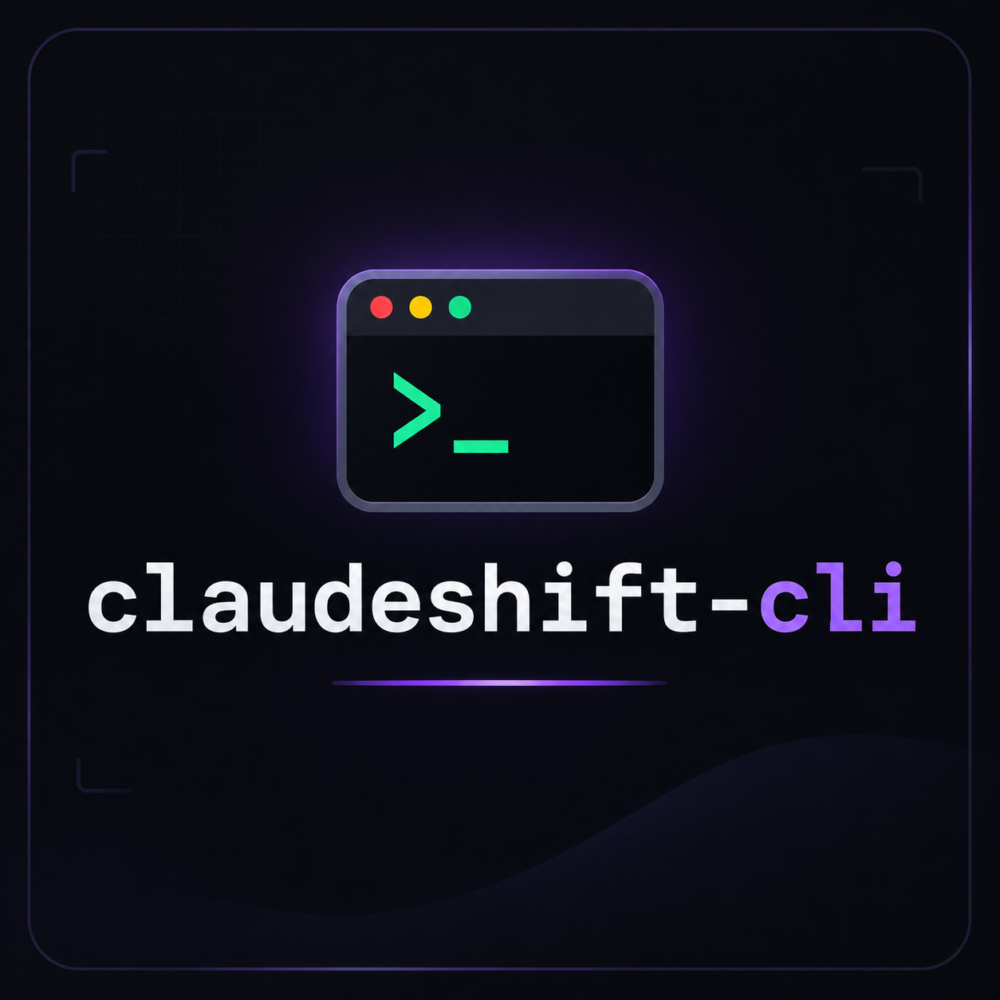
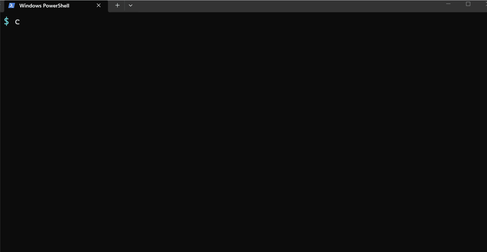

# claudeshift-cli

Local-first profile switcher, MCP vault, and 5-hour quota radar for AI CLIs.

**[Get claudeshift-cli Pro ($19 One-Time) on Gumroad →](https://mgm15.gumroad.com/l/claudeshift-cli)**

[](https://pypi.org/project/claudeshift-cli/)
[](https://www.python.org/downloads/)
[](https://github.com/mohamed2003-mgd/claudeshift-cli/blob/main/LICENSE)



### Live Demo



---

## Why claudeshift-cli?

Switching between work, personal, and client AI accounts usually means manually shuffling config files and breaking MCP setups—or hitting a 5-hour session lockout mid-refactor with zero warning.

**claudeshift-cli** solves both **100% locally** with zero cloud telemetry and zero network proxies.

## Supported Providers

* **Claude Code CLI** (profiles, MCP configs, local JSONL token & 5h quota telemetry)
* **Claude Desktop** (config/MCP switching, including Windows MS Store builds)
* **OpenAI Codex CLI** (profiles & local token/quota telemetry)
* **Gemini CLI** (profile switching)
* **Cursor** (profile switching)

## Installation

```bash
pipx install claudeshift-cli
```

Or via `pip`:

```bash
pip install claudeshift-cli
```

## Quick Start

```bash
# Inspect detected AI CLIs and local health
claudeshift doctor

# Save your current credentials & MCP config as a named profile
claudeshift save work -p claude

# List saved profiles
claudeshift list -p claude

# Switch atomically with automatic safety rollback
claudeshift use personal -p claude

# View local token usage & estimated cost
claudeshift usage

# Sync latest model pricing catalog
claudeshift pricing sync
```

## Free (MIT) vs Pro ($19 One-Time)

| Feature | Free (MIT) | Pro ($19 Lifetime) |
| :--- | :---: | :---: |
| Atomic profile & MCP switching | Up to 2 profiles / provider | **Unlimited profiles** |
| Local usage summaries (`usage`) & `doctor` | Yes | Yes |
| Auto-sync refreshed tokens before switching | Yes | Yes |
| Live 5-hour quota & burn-rate radar (`monitor`) | — | **Yes** |
| Rolling safety backups & restore | — | **Yes** |
| Profile & MCP config diffing | — | **Yes** |
| Billing & usage exports (CSV / JSON) | — | **Yes** |

Already purchased Pro? Activate once (includes 14-day offline grace window):

```bash
claudeshift license activate <YOUR-GUMROAD-KEY>
claudeshift license status
```

## Security & Hardening

* **100% Local-First:** Reads local files only; never sends prompts, tokens, or credentials to third-party servers.
* **Crash-Safe Atomic Swaps:** Stages files on the same filesystem with automatic rollback on Windows file locks.
* **Integrity & Path Guards:** SHA-256 verification, symlink-escape protection, path-traversal guards, CSV formula-injection neutralization, and Windows long-path (`\\?\`) support.
* **Verified:** 70 automated unit and red-team tests passing across Windows, Linux, and macOS.

## License

Core CLI is released under the [MIT License](LICENSE).